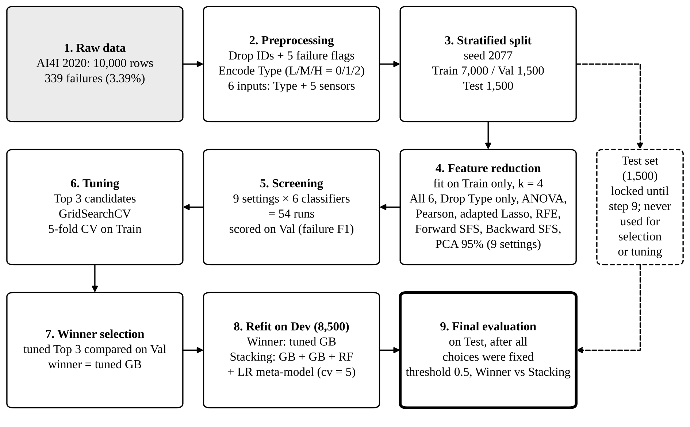
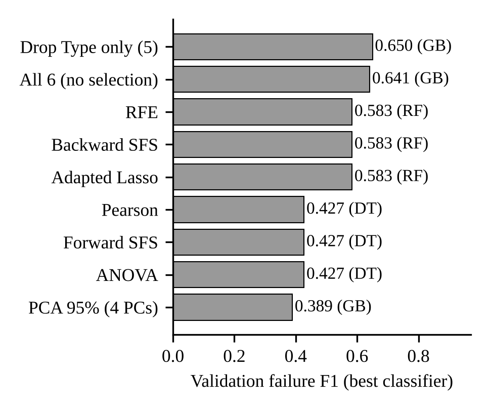
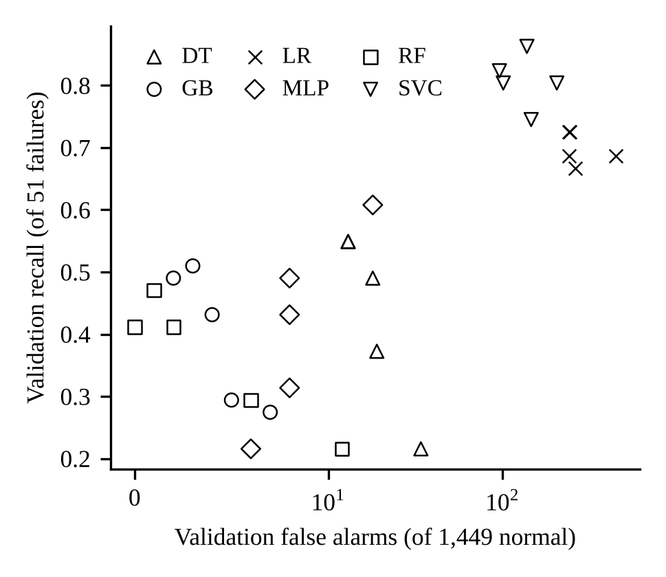

# 🛠️ Predictive Maintenance: Machine Failure Classification
> *A Comparative Benchmark of Feature Reduction Strategies and Classifiers for Imbalanced Machine Failure Detection*

[](https://www.python.org/)
[](https://scikit-learn.org/)
[](./LICENSE)

> 📄 **Paper:** *A Comparative Benchmark of Feature Reduction Strategies and Classifiers for Imbalanced Machine Failure Detection* — Udtarakviseth Lay, Sothea Sokea, Panyanat Aonpong. **The 15th Asia Undergraduate Conference on Computing (AUC² / AUCC) 2027**.
>
> This repository contains the code that produced the paper's results: [`notebooks/paper_pipeline.ipynb`](./notebooks/paper_pipeline.ipynb).
>
> If you use this code, please cite it via [`CITATION.cff`](./CITATION.cff).

---

## 📌 Summary

Machine failures are rare (3.39% of records in AI4I 2020), so accuracy alone is misleading: always predicting "no failure" already scores 96.61%. We rank models by **failure-class F1** and report recall, precision, missed failures and false alarms directly.

We benchmark **7 feature reduction strategies** (ANOVA, Pearson correlation, adapted Lasso, RFE, Forward SFS, Backward SFS, PCA 95%), plus an **all-6 baseline** and a **Drop Type only** control, against **6 classifiers**: 9 settings × 6 classifiers = **54 combinations**. We use a stratified **70/15/15** train/validation/test split with **seed 2077**, and fit every selector, scaler and PCA on the training split only.

**Main results:**
- Every four-feature subset lost F1 against all six inputs; dropping only Type was roughly neutral.
- Tuning raised the validation F1 of Gradient Boosting from **0.641 to 0.713**.
- Tuned Gradient Boosting reached a **test F1 of 0.729**: recall 0.608 (31/51), precision 0.912, 3 false alarms, ROC-AUC 0.973, PR-AUC 0.787.
- Stacking (F1 0.753, 32/51, 2 false alarms) did not clearly beat the single model.

---

## 📊 Dataset & Input Features

The **AI4I 2020 Predictive Maintenance Dataset** (UCI / Kaggle) has 10,000 synthetic records that imitate a milling machine. The target is `Machine failure`: 339 failures (3.39%) and 9,661 normal records (96.61%).

| Feature | Unit | Description |
| :--- | :---: | :--- |
| `Type` | – | Product quality variant (L/M/H, encoded 0/1/2) |
| `Air temperature [K]` | K | Ambient temperature |
| `Process temperature [K]` | K | Machine operating temperature |
| `Rotational speed [rpm]` | rpm | Spindle speed |
| `Torque [Nm]` | Nm | Torque during operation |
| `Tool wear [min]` | min | Cumulative cutting time |

> [!NOTE]
> **Target leakage prevention:** we drop the identifiers (`UDI`, `Product ID`) and the five failure-mode flags (`TWF`, `HDF`, `PWF`, `OSF`, `RNF`). The flags define the label itself and would not be known before a diagnosis.

---

## 🔬 Methodology



*Fig. 1. Feature reduction and tuning are fitted on the training split, while screening and selection are scored on the validation split. The final models are refit on the development set, and the test split is used only after all choices are fixed.*

| Split | Rows | Normal | Failure | Failure (%) |
| :--- | ---: | ---: | ---: | ---: |
| Training | 7,000 | 6,763 | 237 | 3.39 |
| Validation | 1,500 | 1,449 | 51 | 3.40 |
| Test | 1,500 | 1,449 | 51 | 3.40 |
| Development (Train + Val) | 8,500 | 8,212 | 288 | 3.39 |

- **Feature reduction:** every selector keeps **k = 4** features. The adapted Lasso is a standardized L1 logistic regression (C = 0.1) ranked by absolute coefficient. RFE uses a Logistic Regression base. Forward and Backward SFS use a Decision Tree base with 5-fold CV F1. PCA keeps 95% of the training variance (4 components).
- **Classifiers:** SVC (RBF), Logistic Regression, Decision Tree, Random Forest (200 trees), Gradient Boosting, and MLP (64, 16). SVC, LR and MLP get standardized inputs. SVC, LR, DT and RF use balanced class weights. Everything else uses scikit-learn defaults with `random_state = 2077` and no resampling.
- **Tuning:** the top 3 combinations are tuned with GridSearchCV (16 combinations each, 5-fold stratified CV on the training split, F1). The tuned model with the best validation F1 is the winner.
- **Stacking benchmark:** tuned GB (all 6) + tuned GB (Drop Type only) + tuned RF (all 6), with a Logistic Regression meta-model (cv = 5). It is scored only on the test split.
- **Threshold** fixed at 0.5.

---

## 🏆 Results

### Table 3. Selector scores (training split) and the two sensor sets chosen at k = 4

| Feature | ANOVA F | p | \|r\| | \|L1\| | Set A | Set B |
| :--- | ---: | ---: | ---: | ---: | :---: | :---: |
| Type | 8.34 | 0.0039 | 0.035 | 0.133 | – | – |
| Air temp. | 54.55 | <0.001 | 0.088 | 1.116 | Y | Y |
| Proc. temp. | 7.90 | 0.0050 | 0.034 | 0.729 | – | Y |
| Rot. speed | 30.91 | <0.001 | 0.066 | 1.706 | Y | Y |
| Torque | 348.32 | <0.001 | 0.218 | 2.433 | Y | Y |
| Tool wear | 70.70 | <0.001 | 0.100 | 0.651 | Y | – |

**Set A:** ANOVA, Pearson, Forward SFS (DT base). **Set B:** adapted Lasso, RFE (LR base), Backward SFS (DT base).

### Table 4. Screening: best classifier per feature setting (validation, 51 failures / 1,449 normal)

| Setting | Inputs | Model | F1 | Recall | Precision | Missed | False alarms |
| :--- | :---: | :---: | :---: | :---: | :---: | :---: | :---: |
| **Drop Type only** | 5 | GB | **0.650** | 0.510 | 0.897 | 25 | 3 |
| All 6 (no selection) | 6 | GB | 0.641 | 0.490 | 0.926 | 26 | 2 |
| Set B: Lasso / RFE / Backward SFS | 4 | RF | 0.583 | 0.412 | 1.000 | 30 | 0 |
| Set A: ANOVA / Pearson / Forward SFS | 4 | DT | 0.427 | 0.373 | 0.500 | 32 | 19 |
| PCA 95% | 4 PCs | GB | 0.389 | 0.275 | 0.667 | 37 | 7 |

<p>
  
  
</p>

*Fig. 2 (left): best validation failure F1 per feature setting. Fig. 3 (right): validation recall versus false alarms for all 30 unique fits (threshold 0.5).*

### Table 5. Tuned finalists

| Candidate | Best parameters | CV F1 (mean ± sd) | Val F1 after tuning | Val missed / FA |
| :--- | :--- | :---: | :---: | :---: |
| **GB, All 6** | learning rate 0.1, depth 5, 200 trees, subsample 1.0 | 0.767 ± 0.071 | **0.713** | 20 / 5 |
| GB, Drop Type only | learning rate 0.1, depth 5, 200 trees, subsample 1.0 | 0.738 ± 0.061 | 0.675 | 23 / 4 |
| RF, All 6 | no class weight, unlimited depth, min. leaf 1, 200 trees | 0.711 ± 0.089 | 0.675 | 24 / 2 |

Tuning raised the validation F1 of GB on all six inputs from **0.641 to 0.713**, so it was selected as the winner.

### Table 6. Robustness: five re-splits of the development set (seeds 11, 22, 33, 44, 66)

Each seed re-splits the 8,500 development rows into 7,000 train / 1,500 validation. The test set is never used.

**(a) Best-classifier validation F1 per setting (mean ± sd)**

| Setting | F1 | Setting | F1 |
| :--- | :---: | :--- | :---: |
| **All 6** | **0.759 ± 0.052** | Forward SFS k=4 | 0.594 ± 0.081 |
| Drop Type only | 0.739 ± 0.023 | Lasso k=4 | 0.572 ± 0.054 |
| PCA 99% (6 PCs) | 0.738 ± 0.094 | ANOVA k=4 | 0.552 ± 0.037 |
| RFE k=4 | 0.683 ± 0.071 | Pearson k=4 | 0.552 ± 0.037 |
| Backward SFS k=4 | 0.626 ± 0.077 | PCA 95% (4 PCs) | 0.424 ± 0.067 |

**(b) Best F1 by number of retained inputs (GB and MLP)**

| Inputs | 3 | 4 | 5 | 6 | PCA 95% | PCA 99% |
| :--- | :---: | :---: | :---: | :---: | :---: | :---: |
| GB | 0.562 ± 0.024 | 0.645 ± 0.078 | 0.727 ± 0.034 | 0.745 ± 0.041 | 0.361 ± 0.063 | 0.581 ± 0.059 |
| MLP | 0.515 ± 0.031 | 0.683 ± 0.071 | 0.690 ± 0.054 | 0.746 ± 0.068 | 0.395 ± 0.103 | 0.738 ± 0.094 |

### Table 7. Test set (1,500 records, 51 failures, threshold 0.5)

| Model | TN | FP | FN | TP | F1 | Recall | Precision | Bal. acc. | ROC-AUC | PR-AUC |
| :--- | ---: | ---: | ---: | ---: | :---: | :---: | :---: | :---: | :---: | :---: |
| **Tuned GB (winner)** | 1446 | 3 | 20 | 31 | **0.729** | 0.608 | 0.912 | 0.803 | **0.973** | **0.787** |
| Stacking (tuned Top 3) | 1447 | 2 | 19 | 32 | 0.753 | 0.627 | 0.941 | 0.813 | 0.962 | 0.746 |

The Wilson 95% CI for the winner's recall (31/51) is [0.471, 0.730], and for Stacking (32/51) it is [0.490, 0.747].

---

## 💡 Takeaways

1. **Every four-feature subset lost F1.** On the validation split, the best subset reached 0.583 against 0.641 for all six inputs. Over five development re-splits, selector subsets reached 0.552–0.683 and PCA 95% reached 0.424, against 0.759. This fits how the data are generated: heat-dissipation failures depend on the process–air temperature difference with low speed, power failures on torque × speed, and overstrain failures on tool wear × torque. Every sensor appears in at least one failure rule.
2. **Dropping Type was roughly neutral** (0.739 vs 0.759 over five re-splits). Type is a product label, not a sensor.
3. **The classifiers trade recall for false alarms differently.** At the default threshold, Logistic Regression and SVC (balanced weights) caught 67–86% of failures but raised 96–446 false alarms per 1,449 normal records. Gradient Boosting and Random Forest caught 22–51% with 0–12 false alarms. At equal recall, Gradient Boosting gave the fewest false alarms.
4. **Stacking did not clearly beat a single model.** It caught one more failure and raised one fewer false alarm, but the confidence intervals overlap almost completely and its ROC-AUC and PR-AUC were lower. A single tuned Gradient Boosting model is the simpler choice to deploy.

These conclusions are limited to one synthetic dataset.

---

## 📁 Repository Structure

```text
AUCC-Paper-Machine-Failure-Classification/
├── notebooks/
│   └── paper_pipeline.ipynb      # Paper pipeline (with outputs)
├── results/                      # Written by the notebook
│   ├── full_results_for_paper.txt
│   ├── screening_all.csv
│   ├── robustness_dev_only.csv
│   ├── robustness_summary.txt
│   ├── threshold_check_val.csv
│   ├── latest_experiment_report.md
│   └── experiment_runs_log.txt
├── figures/
│   ├── fig1_workflow.png                # Paper Fig. 1
│   ├── fig2_validation_f1.png           # Paper Fig. 2
│   ├── fig3_recall_vs_false_alarms.png  # Paper Fig. 3
│   ├── validation_f1_by_setting.png     # Written by the notebook
│   └── test_confusion_roc.png           # Written by the notebook
├── archive/                      # Earlier course-version code (not used for the paper)
├── data/
│   └── README.md                 # How the dataset is fetched (no raw data committed)
├── requirements.txt
├── .python-version
├── CITATION.cff
├── LICENSE
└── README.md
```

---

## 🚀 Reproducing the Results

The paper used Python 3.13.9, scikit-learn 1.7.2, NumPy 2.3.5 and pandas 2.3.3. Other versions may give slightly different numbers.

```bash
pip install -r requirements.txt
```

1. Open [`notebooks/paper_pipeline.ipynb`](./notebooks/paper_pipeline.ipynb).
2. The dataset is fetched automatically with `kagglehub` (see [`data/README.md`](./data/README.md)).
3. Run all cells from top to bottom. Tables and CSVs are written to [`results/`](./results/), and plots to [`figures/`](./figures/).

Or run it headless:

```bash
jupyter nbconvert --to notebook --execute --inplace notebooks/paper_pipeline.ipynb
```

The main settings are in **Section 7 (Master Experiment Configuration)** of the notebook: `NUMBER_OF_FEATURES = 4`, `RFE_SELECTOR_MODEL`, `SFS_SELECTOR_MODEL`, `PCA_VARIANCE = 0.95` and `CV_FOLDS = 5`. The main seed is `RANDOM_STATE = 2077` (Section 4), and the robustness seeds are `ROBUST_SEEDS = [11, 22, 33, 44, 66]` (Section 16.3).

---

## 👥 Authors & Academic Context
- **Authors**: Udtarakviseth Lay ([@Viseth101](https://github.com/Viseth101)), Sothea Sokea ([@sotheasokea](https://github.com/sotheasokea)), Panyanat Aonpong (corresponding author)
- **Course**: Machine Learning (Lab & Term Project Assignment)
- **Year & Semester**: Year 3 (Junior), Semester 1
- **Institution**: Silpakorn University
